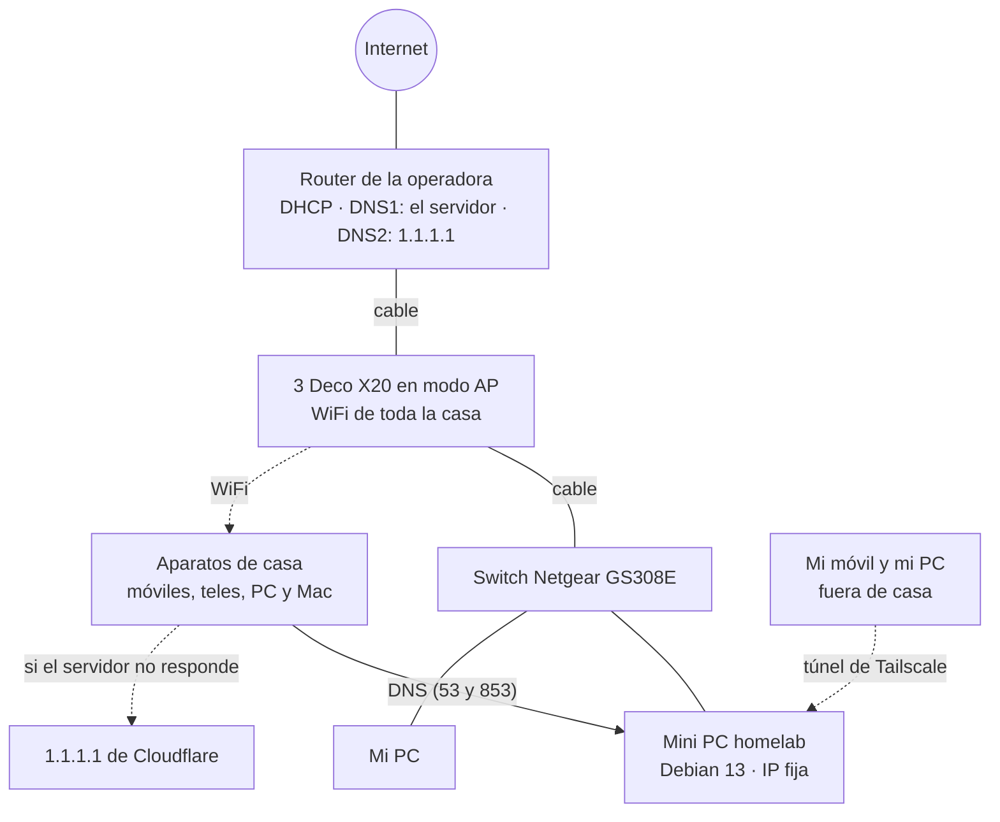
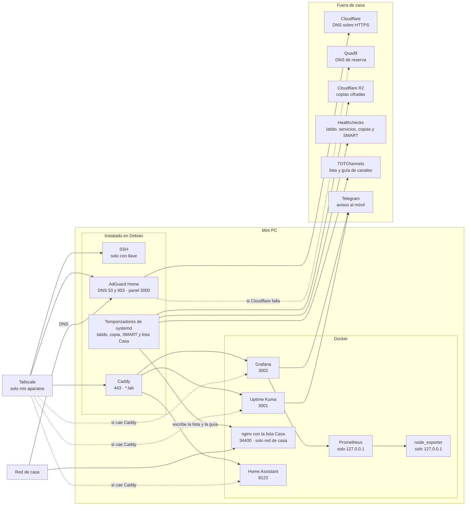

# La red

## La casa

El switch cuelga de uno de los Deco, y de él salen el mini PC y mi PC. El resto de la casa va por WiFi.

Cada aparato recibe del router dos DNS: el del servidor y 1.1.1.1. Si el servidor se apaga, los aparatos pasan solos a 1.1.1.1 y la casa sigue con internet, aunque sin filtrar.

El router no reenvía ningún puerto al servidor. El túnel de Tailscale lo abre el propio servidor hacia fuera, así que desde internet no se puede llegar a él.

## Dentro del mini PC

AdGuard y Caddy van instalados en el sistema, sin Docker. AdGuard es la pieza de la que depende la familia y así arranca aunque Docker falle. Pregunta a Cloudflare por DNS sobre HTTPS y, si no responde, a Quad9. El propio servidor resuelve con 1.1.1.1 y, de reserva, 9.9.9.9.

Los temporizadores hacen cuatro cosas: cada 5 minutos el latido le pregunta a AdGuard y a Uptime Kuma y avisa a Healthchecks, a las 04:00 se hace la copia en R2, a las 04:45 se preparan la lista de canales y su guía, y a las 09:00 se mira la salud del disco.

## Quién llega a qué

| Puerto | Servicio | Desde dónde |
| --- | --- | --- |
| 22 | SSH | Casa y Tailscale |
| 53 y 853 | DNS de AdGuard (normal y cifrado) | Casa y Tailscale |
| 3000 | Panel de AdGuard | Casa y Tailscale |
| 443 | Caddy (`kuma.lab`, `grafana.lab` y `ha.lab`) | Solo Tailscale |
| 3001 | Uptime Kuma | Solo Tailscale (normalmente por Caddy) |
| 3002 | Grafana | Solo Tailscale (normalmente por Caddy) |
| 8123 | Home Assistant | Solo Tailscale (normalmente por Caddy) |
| 34400 | Lista Casa | Solo casa |
| 9090 y 9100 | Prometheus y node_exporter | Solo el propio servidor |

UFW solo deja pasar lo de esta tabla. Docker se salta UFW, así que los puertos de contenedores con red propia los publico en la IP de casa del servidor o en `127.0.0.1`, según quién tenga que llegar. Los que usan la red del sistema, como Kuma, Grafana y Home Assistant, sí pasan por UFW.
